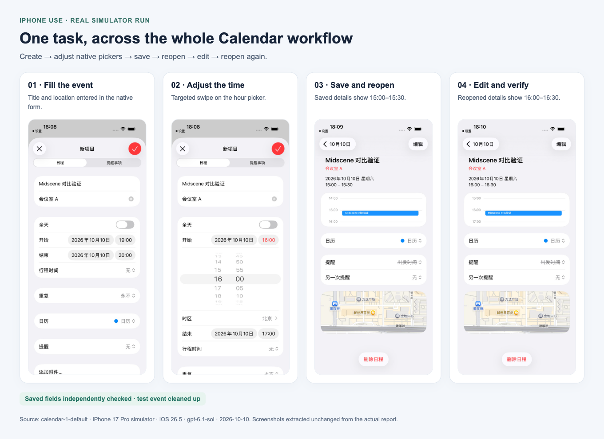
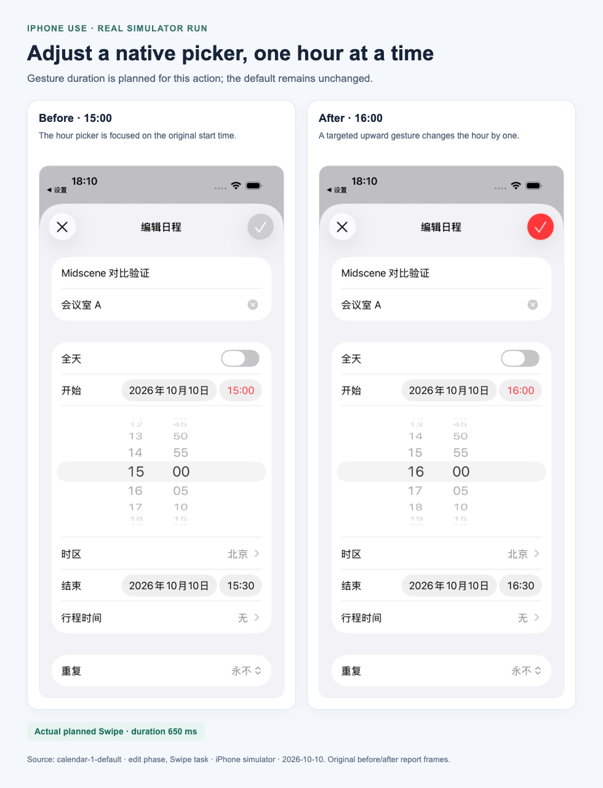
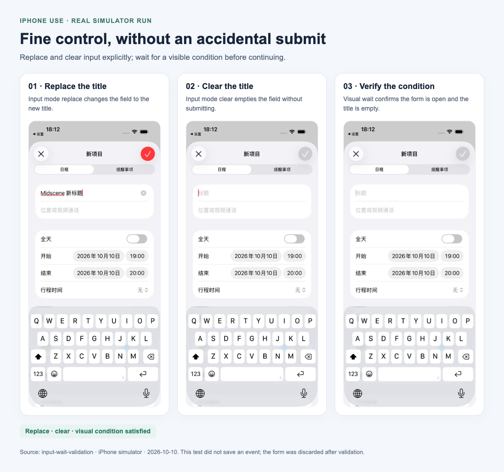
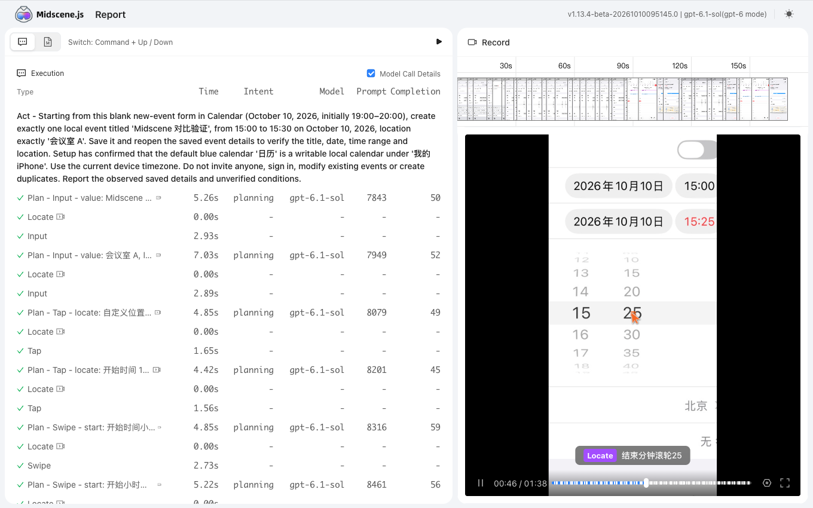

# iPhone Use: task execution and reports

These screenshots come from completed iPhone simulator runs. The phone frames are original report images, placed in a labeled layout. They show actual results rather than UI mockups. AI examples use separate Sign in with ChatGPT authorization; default single-step actions and reports do not require this authorization.

## Complete a task across multiple screens

The Calendar run filled a title and location, adjusted native time pickers, saved the event, reopened its details, edited its time, and reopened it again. Independent checks verified the saved fields after each phase; the test event was cleaned up.

## Make a small, deliberate gesture

The edit phase moved the hour picker from 15:00 to 16:00 with a targeted upward swipe. This action planned a 650 ms duration. The SDK's default swipe duration remains 300 ms; the per-action parameter controls this gesture.

## Change text without submitting the form

The input test replaced the title, cleared it, and used a visual condition wait to confirm that the form remained open with an empty title. No event was saved; the form was discarded afterward. The third frame shows the observed state for the successful wait, not a separate phone interaction.

## Review what happened in one report

A shared `report_id` keeps the task's actions and observations together. The actual HTML viewer below shows the execution list, per-step timings, recorded screen timeline, and a located picker target. It supports replaying the recorded task and inspecting individual steps.

## Evidence sources

| Example | Run / execution | Captured frames |
|---|---|---|
| Calendar workflow | `calendar-1-default`, create and edit phases | Create action tasks 8, 14, 38; edit action task 18 |
| Hour picker | `calendar-1-default`, edit phase | Swipe task 9, original before/after frames; duration 650 ms |
| Input and wait | `input-wait-validation` | Input tasks from executions 0 and 1; successful WaitFor from execution 2 |
| HTML viewer | `iphone-use-calendar-1-default.html` | Browser screenshot of the actual native report viewer |

Runs were recorded on October 10, 2026 with `gpt-6.1-sol` and Midscene `1.13.4-beta-20261010095145.0`. The Calendar run used an iPhone 17 Pro simulator running iOS 26.5. These images document functional behavior; they do not establish comparative speed or real-device reliability.

Only display screenshots are included here. Local authorization files, full model logs, and private runtime state are not included.
